AccessPilotArchitecture

Start here

1\. What AccessPilot is 2. System architecture 3. Identity connectors

Identity lifecycle

4\. Joiner / Mover / Leaver 5. Automatic failed-account retry

HR integration new

6\. HR connection (pull sync) 7. Standalone HR test app 8. HR-triggered sync (PAT) 9. Multi-directory provisioning

Access engine

10\. Access Assignments 11. Access Packages 12. Business Roles 13. Group→Role mapping 14. Birthright policies 15. Workflows

Governance

16\. Separation of Duties 17. Access Reviews 18. Entitlement Catalog 19. Privileged / Test accounts 20. Non-Human Identities

Org & platform

21\. Org Chart & Departments 22. CSV Onboarding 23. Notifications & Audit 24. Dashboards 25. Security & platform 26. Background workers 27. Page map

Identity Governance & Administration Platform

# AccessPilot

A complete architectural and feature reference — every governed flow, every background process, and every connector, each with its own diagram. Built to hand to anyone who needs to understand how the system actually works, not just what it's called.

**Stack** Python/FastAPI · PostgreSQL · React/TypeScript **Connectors** Microsoft Entra ID · Okta · Active Directory · CSV/HR feed **Updated** October 2026

01

## What AccessPilot is

AccessPilot is an **Identity Governance and Administration (IGA)** platform. It sits on top of one or more real identity directories and governs **who has access to what, for how long, and under whose approval** — without ever becoming the directory itself. It never replaces Entra, Okta, or Active Directory as the system of record for authentication; it reads from them, writes governed changes back to them, and layers a request → approval → activation → expiry → review lifecycle on top that none of them provide natively.

Every "live" feel in the UI is short-interval polling, not push infrastructure. There is no websocket layer anywhere in the system — background workers re-check state every 60 seconds and the frontend re-fetches on a similar cadence.

02

## System architecture

One FastAPI backend, one Postgres database, a set of always-on background workers sharing the same process, and a React single-page frontend. Every directory connector implements the same abstract interface, so the rest of the application never has to know which real directory a person's account lives in.

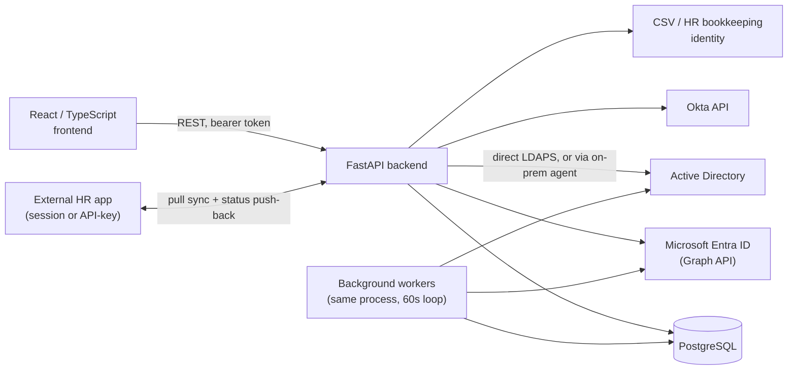

The backend is the only thing that ever talks to a real directory or an external HR system. The frontend only ever talks to the backend.

03

## Identity connectors

One abstract `IdentityProvider` interface, implemented per connector. Every connector exposes the same shape — read users/groups/roles/applications, write (enable/disable, attribute edits, group membership), and provision (create a new account or group) — so the rest of the application is written once, against the interface, never against a specific vendor.

| Connector | Reads | Writes | Provisions |
| --- | --- | --- | --- |
| **Microsoft Entra ID** | Users, Groups, Directory Roles, Enterprise Applications + app roles | Enable/disable, attributes, group/role/app-role membership | Create user, create group |
| **Okta** | Users, Groups | Enable/disable, attributes, group membership | Create user |
| **Active Directory** (LDAP/LDAPS) | Users, Groups (direct membership) | Enable/disable, attributes, group membership | Create user (one-time password), create security group |
| **CSV / HR feed** | Push-based only | — | Bookkeeping identity that graduates into a real account once one becomes available |

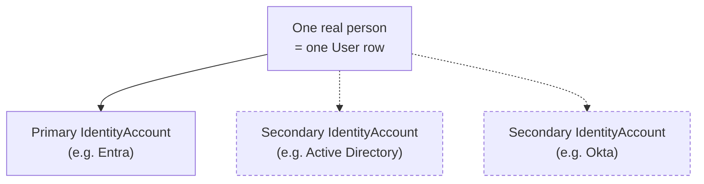

Multi-directory account mapping: every grant resolves the account in the specific directory the resource being granted actually lives in — auto-provisioning a secondary account on the spot if the person doesn't have one there yet.

04

## Joiner / Mover / Leaver

The identity lifecycle engine. One state machine per person, driven by directory sync, CSV/HR import, or direct admin action.

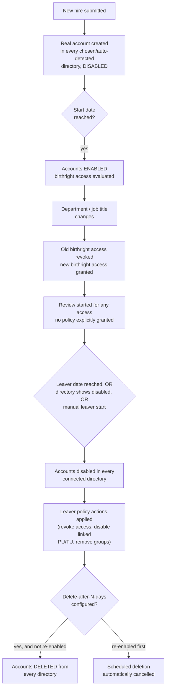

### Joiner

- One form submission creates a real, disabled account in every chosen directory and shows each one-time temporary password once.
- Directories can be picked explicitly, or **auto-detected** from whichever directories the person's department's birthright policies would grant access in.
- Optional profile fields (office, company, phone, address, description) apply symmetrically to every target directory at creation time.
- **Global provisioning delay** (admin-configurable): account creation can be deferred N days after submission — unless that would land past the person's own start date, in which case it's still created immediately.

### Mover

- Triggered by a directory sync, a CSV row, or an in-app edit changing department/job title.
- Department/job-title edits now mirror to **every** connected directory the person has an account in, not just their primary one.

### Leaver

- Governed by **Leaver Policies** — scoped by department or employment type, or a Default policy covering everyone else.
- Each policy decides: revoke AccessPilot access? disable accounts? disable linked PU/TU accounts? remove from all groups (even ones AccessPilot didn't grant)? and optionally **delete accounts N days later**.
- Re-enabling a leaver's account always requires a written reason and manager/lifecycle-owner approval.
- The Leaver log separately filters: disabled, accounts deleted, and deletion cancelled (re-enabled in time) — three distinct, auditable outcomes.

05

## Automatic failed-account retry new

If a directory (AD DS or Entra) was unreachable at the exact moment a Joiner's account was being created, that one target used to stay FAILED forever, until an admin noticed and clicked Retry by hand.

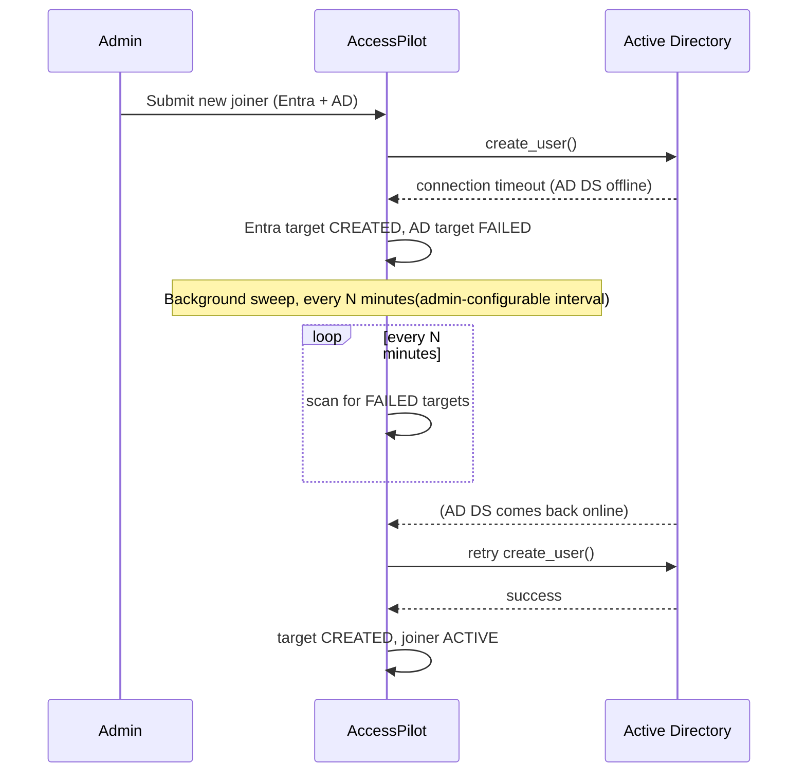

An admin-configurable interval ("Retry failed joiner accounts every N minutes," blank = manual Retry only) controls how often a background sweep re-checks every still-failed target on every in-progress joiner and retries it automatically — the exact same code path the manual Retry button already used, just triggered on a schedule instead of a click.

06

## HR connection (pull sync) new

AccessPilot can automatically pull employee data from an external HR application on a schedule, feeding the exact same validation and commit flow as a manual CSV upload — including leaver handling, driven entirely by that HR app's own `leaverDate`/`status` columns.

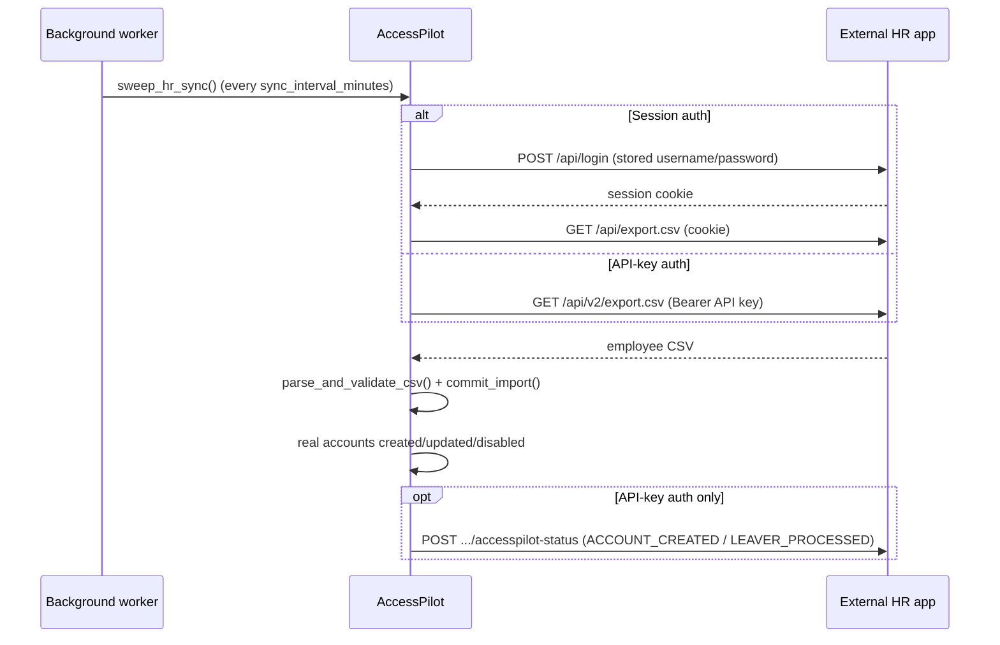

Two supported authentication methods, selectable on the HR connection panel:

| Method | How it authenticates | Status push-back |
| --- | --- | --- |
| **Username / password** | Logs in (`POST /api/login`), uses the session cookie for one fetch | Not supported |
| **API key (recommended)** | `Authorization: Bearer <key>`, no login step | Yes — reports account-created/leaver-processed events back |

Both credentials are encrypted at rest with the same mechanism every other provider credential already uses. Neither is ever returned by the API once saved.

07

## Standalone HR test application new

A second, independent application ("HR Employee Directory v2") built specifically to exercise the API-key integration path end to end — a real employee list, add/edit, and its own API-key generator.

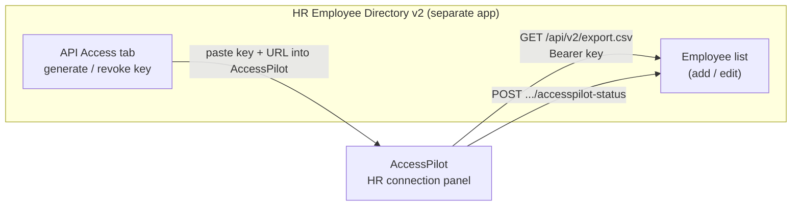

- Employee fields match AccessPilot's onboarding contract exactly: `employeeId, firstName, lastName, email, department, status` (required) plus `jobTitle, managerId, employeeCategory, employmentType, startDate, effectiveDate, leaverDate` (optional).
- One active API key at a time — generating a new one immediately revokes the previous.
- A read-only "AccessPilot status" strip on each employee row shows what AccessPilot has reported back.

08

## HR-triggered sync via Personal Access Token new

Lets the external HR app's own "Sync" button kick off a real AccessPilot sync, without the HR app ever holding an AccessPilot admin login — a narrowly-scoped token that can do exactly one thing.

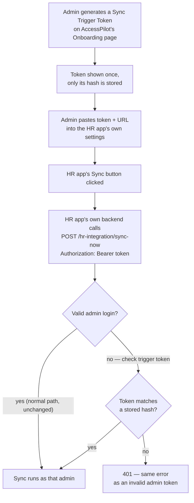

The token is an **additive fallback** inside the existing permission check — the real admin-login path is always tried first and is completely unchanged. The token's only capability anywhere in AccessPilot is calling this one sync action. One active token at a time, fully audited and revocable.

09

## Multi-directory provisioning for HR-synced people new

An HR-synced person now gets a real account in **every** directory their department/job-title birthright access needs — not just the one primary provider — mirroring what Joiner has always done.

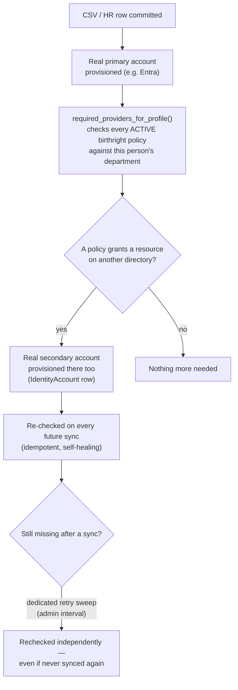

A second admin-configurable interval ("Retry missing HR-synced accounts every N minutes") guarantees this self-heals even for a person who's never re-synced — not just whenever their next HR sync happens to run.

10

## Access Assignments — the core engine

One generic engine handles every kind of grantable resource (Group, Role, Application role) the same way. Nothing about real access changes until the moment it's actually about to become real.

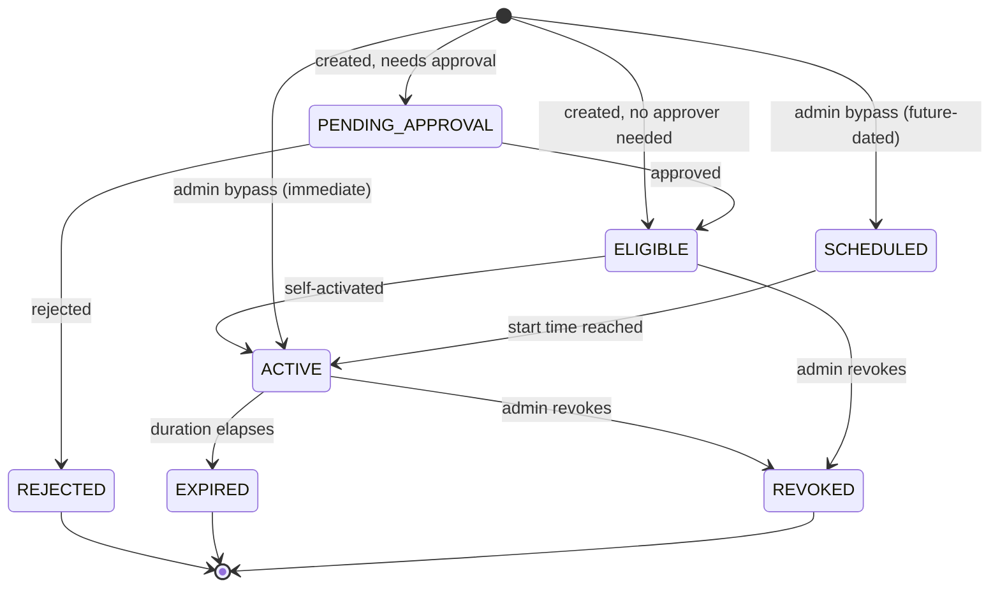

- **Durations**: Permanent or Temporary, worker-enforced expiration.
- **Approval**: a single named approver, or a full multi-stage Workflow.
- **Fallback approver**: a second approver who can act if the primary hasn't within a configurable window.
- **SoD and risk-aware routing** are enforced at every point real access is about to become real.
- **Cascading activation**: a Group with a Group→Role/Application mapping delivers the linked grant in the same action.

11

## Access Packages

Bundles of several Group/Role/Application-role items, assigned as one unit.

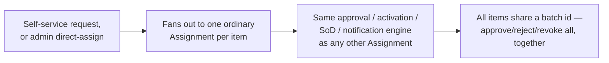

Each package can set its own default approver, fallback approver, or required Workflow. Editing a package only affects future assignments, never retroactive.

12

## Business Roles

A named bundle of entitlements representing a real job function (e.g. "Finance Analyst"), each item optionally tagged with an internal IT reference label. Assigned the same way a Package is — one Assignment per item, same engine, same SoD/approval/notification machinery.

13

## Group → Role/Application mapping

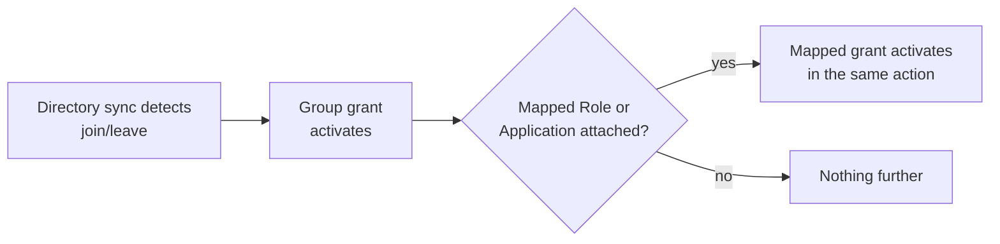

Lets an admin declare "membership in this Group should also carry this Role/Application grant" — and tracks real group membership changes so the mapped grant follows along automatically.

14

## Birthright Policies

Attribute-based automatic access rules: department / job title / employment status / email conditions (AND/OR) that automatically grant a Group, Role, Application, Access Package, or Business Role to anyone matching.

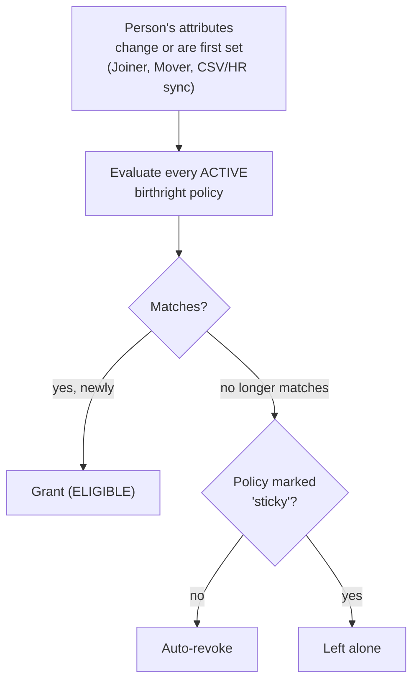

A Package/Business-Role action expands into one tagged grant per item. This same reconciliation logic also determines which directories a new joiner — or a newly HR-synced person — needs real accounts in.

15

## Workflows

A configurable, ordered sequence of approval stages, used as an alternative to a single named approver.

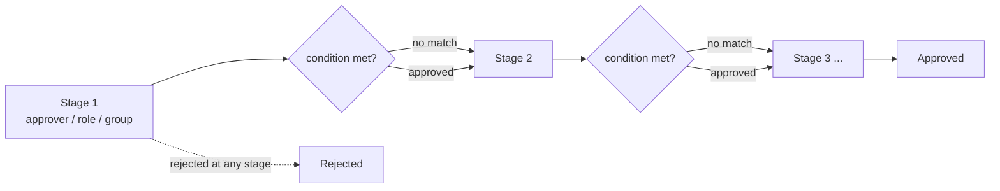

A stage whose condition doesn't match (e.g. `department EQUALS "IT"` for someone outside IT) is **skipped**, not blocking. Multi-item requests sharing one workflow instance are grouped and can be bulk-decided.

16

## Separation of Duties (SoD)

Rules naming two sets of entitlements that must never both be held by the same person.

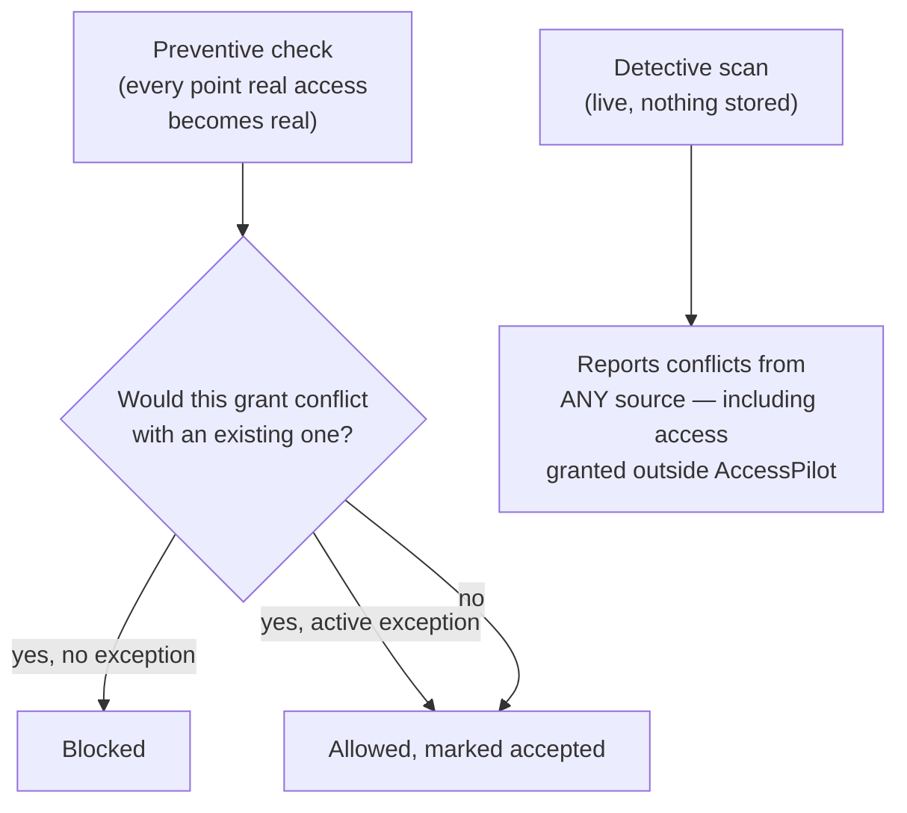

- **Exceptions**: a time-boxed, justified risk acceptance for a specific (policy, user) pair.
- **Cooldown anti-gaming check**: blocks deactivating one side of a conflict just to immediately activate the other.
- Exclusive to a dedicated `SoDAdmin` role — a plain Admin sees nothing SoD-related.

17

## Access Reviews

Periodic "does this access still make sense" certification campaigns.

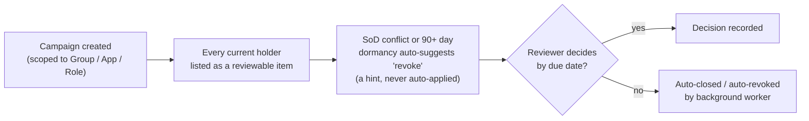

Campaigns can be one-off or recurring. Exportable as a PDF report or CSV per campaign.

18

## Entitlement Catalog

A risk/metadata classification layer over every real Group, Role, and Application role: risk tier (Low/Medium/High/Critical), description, and an assigned owner — auto-created, defaulting to Low/unclassified, the first time it's seen.

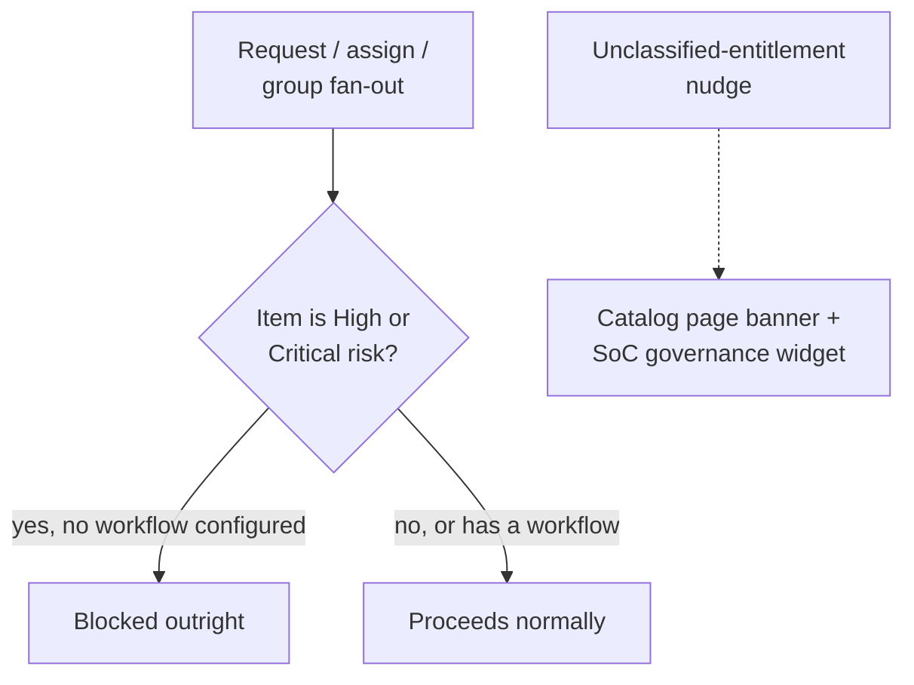

19

## Privileged (PU) & Test (TU) accounts

Shadow accounts linked to a real person for elevated admin work or QA/UAT — deliberately excluded from all birthright/mover automation, since their access is always a deliberate, individual admin decision. Shown on the linked real person's own page; enable/disable follows the owner's own leaver process.

20

## Non-Human Identity (NHI) governance

Treats service principals and application identities as first-class governed entities: ownership, credential expiry tracking, risk flags, and a type classification (service principal, managed identity, etc., with manual override).

21

## Org Chart, Departments & Group Labels

- **Org Chart**: manager/report hierarchy, used to resolve the right approver for movers and leavers when no explicit approver is configured. A Department → Manager mapping lets Joiner auto-suggest the right manager the moment a department is picked.
- **Departments**: an admin-managed canonical list for consistent birthright matching.
- **Group Labels**: an AccessPilot-only classification (Standard/Privileged/custom), never written back to the real directory.

22

## CSV Onboarding

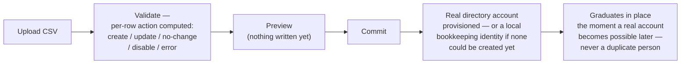

The same engine that powers the HR connection's automatic pull sync (§6) — a manual upload and an automated sync are indistinguishable once the CSV reaches this point.

23

## Notifications & Audit Logging

- **Notifications**: a personal per-user feed (assigned/approved/activated/revoked, etc. — never self-notifies) plus a separate SoD-specific feed for the SoDAdmin team. In-app only, no outbound email/Teams/webhook delivery.
- **Audit Logging**: every consequential action — who, what, on what target, the real directory-call result, a request-correlating id — is recorded. SoD-relevant entries are also filtered into their own feed.

24

## Dashboards

| Dashboard | Audience | What it shows |
| --- | --- | --- |
| **Admin Dashboard** | Admin | Live stat cards, privileged-role-activation timeline, access-mix chart, recent activity — every card deep-links into a pre-filtered list. |
| **Security Operations (SoC)** | SoCAdmin only | Self-service drag-and-drop widgets, click-to-drilldown. Includes the **Identity Risk Posture** number: open SoD violations + dormant access + outliers + overdue reviews, combined. |
| **System Health** | ServerAdmin only | Real infrastructure telemetry — API latency, DB pool, worker liveness, connector status — with a Troubleshooting drill-down. |

25

## Security & platform features

- **Security Settings**: three independent idle-session tiers (blur / lock / auto-logout), a tenant-wide display timezone, an IDP-unreachable fallback contact on the sign-in screen.
- **Branding**: admin-uploadable sign-in logo, internal logo, "powered by" text.
- **Setup wizard**: bootstrap flow for a brand-new install — a one-time generated credential, never a hardcoded default — guiding IDP + Break-Glass configuration.
- **Break-Glass emergency access**: a hidden, token-only URL landing on a narrowly-scoped role that must explicitly elevate (one more deliberate click) to reach full Admin.
- **Environment-portable by design**: no domain or directory address is hardcoded anywhere — the Entra verified domain and the Active Directory base DN are both admin-entered connection settings, so a fresh deployment just means connecting that environment's own directories.

26

## Background workers

One process, one loop, \~60 second interval — each sweep below runs in sequence every tick, most gated behind their own admin-configurable interval so nothing runs more often than an admin actually wants.

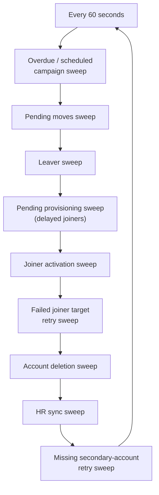

expiryscheduled activation SoD exception expirycampaign auto-close joiner activationleaver run mover applyaccount deletion HR syncjoiner retry secondary-account retry

27

## Page map

### Self-service (every signed-in user)

Dashboard · My Access · My Approvals · My Packages · My Business Roles · My Groups (Group Owners) · My Access Reviews · Request Packages

### Administration

Users · Groups · Roles · Applications · Assignments · Access Packages · Business Roles · Group→Role Mapping · Policies (Birthright) · Entitlement Catalog · Separation of Duties (+ Configuration) · Access Reviews · Audit Logs · Joiners · Movers · Leavers (+ Leaver Policies) · Org Chart · Onboarding (CSV + HR connection + API access) · Providers (+ sync/agent/LDAP config) · Non-Human Identities · Privileged Account Activity · Security Operations · System Health (+ Troubleshooting) · Security Settings · Branding

AccessPilot — internal architecture reference. Generated from the live codebase, October 2026.